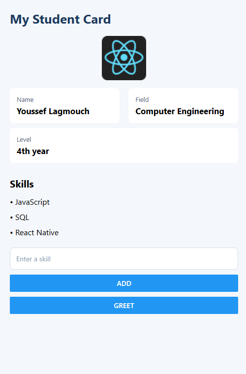
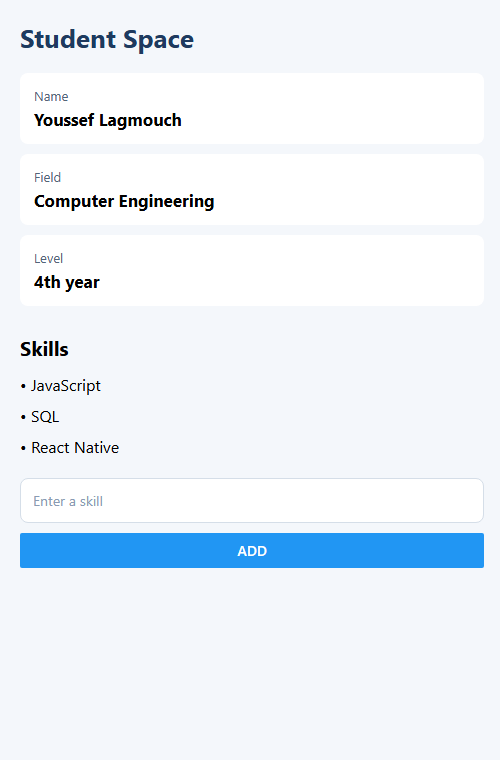

# Student Profile App — React Native Basics

> **Author:** Youssef Lagmouch
> **Stack:** React Native · Expo · JavaScript

---

## Table of contents

1. [Objectives](#1-objectives)
2. [Project structure](#2-project-structure)
3. [Prerequisites](#3-prerequisites)
4. [Part 0 — Opening the project](#4-part-0--opening-the-project)
5. [Part 1 — Handling events](#5-part-1--handling-events)
6. [Exercise 1 — "My Student Card"](#6-exercise-1--my-student-card)
7. [Exercise 2 — "Student Space"](#7-exercise-2--student-space)
8. [Going further (optional)](#8-going-further-optional)
9. [Common mistakes](#9-common-mistakes)
10. [Quick command reference](#10-quick-command-reference)

---

## 1. Objectives

By the end of this lab you will be able to:

- Handle user events with `onPress` and `onChangeText`.
- Build **reusable components** and pass data to them with **props**.
- Store data in an **object** and in an **array**, then display it.
- Render a list with `map()` and a unique `key`.
- Lay out a screen with **Flexbox** and `StyleSheet.create`.
- Make content scrollable with `ScrollView`.

## 2. Project structure

Each exercise is an **independent Expo project** with its own folder and its own `App.js`.

```
student-profile-app/
├── README.md
├── screenshots/
│   ├── exercise1-result.png
│   └── exercise2-result.png
├── exercise1/
│   ├── App.js          <- all the code of Exercise 1
│   ├── app.json
│   ├── index.js
│   ├── package.json
│   └── assets/
└── exercise2/
    ├── App.js          <- all the code of Exercise 2
    ├── app.json
    ├── index.js
    ├── package.json
    └── assets/
```

## 3. Prerequisites

| Tool | Check with | Notes |
| --- | --- | --- |
| Node.js (LTS) | `node -v` | Required to run Expo |
| npm | `npm -v` | Installed with Node.js |
| Visual Studio Code | — | Code editor |
| Expo Go (phone) **or** an emulator | — | To view the app. The browser also works (`w` key) |

---

## 4. Part 0 — Opening the project

1. Open **Visual Studio Code**.
2. Go to **File → Open Folder…** and choose the project folder (`exercise1` or `exercise2`).
3. Open the integrated terminal (`` Ctrl + ` ``) and run:

```bash
cd exercise1        # or: cd exercise2
npm install         # only the first time
npx expo start
```

- `cd` enters the project folder.
- `npx expo start` launches the Expo development server.

4. Once the server is running, open the app:
   - **Phone:** scan the QR code with **Expo Go**.
   - **Emulator:** press `a` (Android) or `i` (iOS).
   - **Browser:** press `w`, or run `npx expo start --web`.

---

## 5. Part 1 — Handling events

An **event** is an action of the user or an interaction with the interface. React Native provides, among others, `onPress` for presses on a button and `onChangeText` for changes in a text field.

### React to a press

```jsx
<Button
  title="Show a message"
  onPress={() => alert('Hello!')}
/>
```

The function passed to `onPress` runs when the user presses the button. **You must pass a function**, not call it directly while rendering.

### Read the typed text

```jsx
<TextInput
  placeholder="Your first name"
  onChangeText={(text) => console.log(text)}
/>
```

On every change of the field, `onChangeText` receives the new text. Here it is sent to the console.

### Work to do

Add a **"Greet"** button that shows an alert when pressed, and a `TextInput` that prints the typed characters in the console.

> ⚠️ **Attention:** writing `onPress={alert('Hello')}` runs the instruction **immediately**.
> Use `onPress={() => alert('Hello')}` instead.

---

## 6. Exercise 1 — "My Student Card"

Create a mobile app called **"My Student Card"** reusing the notions studied.

### Requirements

| # | Requirement | Where in the code |
| --- | --- | --- |
| 1 | Screen with the title "My Student Card" | `<Text style={styles.title}>` |
| 2 | Show name, field and level with a reusable `InfoCard` component | `InfoCard` |
| 3 | Use **props** to pass the title and value to each card | `title`, `value` |
| 4 | `TextInput` with placeholder "Enter a skill" | `<TextInput placeholder=… />` |
| 5 | **"Add"** button showing a confirmation alert | `<Button title="Add" … />` |
| 6 | An image representing the student | `<Image … />` |
| 7 | An additional custom component to display a skill | `SkillItem` |
| 8 | Two cards on the same row with **Flexbox** | `flexDirection: 'row'` |
| 9 | Consistent style: background, title sizes, spacing, alignment | `StyleSheet.create` |

### Step by step

**Step 1 — Imports.** Import React, the `useState` hook and the components used.

```jsx
import React, { useState } from 'react';
import { Alert, Button, Image, ScrollView, StyleSheet, Text, TextInput, View } from 'react-native';
```

**Step 2 — Reusable `InfoCard` component.** It receives `title` and `value` through props and displays them in a `View`. The optional `style` prop lets us resize a card (used for Flexbox).

```jsx
function InfoCard({ title, value, style }) {
  return (
    <View style={[styles.card, style]}>
      <Text style={styles.label}>{title}</Text>
      <Text style={styles.value}>{value}</Text>
    </View>
  );
}
```

**Step 3 — Custom `SkillItem` component.**

```jsx
function SkillItem({ name }) {
  return <Text style={styles.skill}>• {name}</Text>;
}
```

**Step 4 — Store the typed skill.** `useState` keeps the text of the field. `onChangeText` updates it (and logs it).

```jsx
const [skill, setSkill] = useState('');
```

**Step 5 — Build the screen.** Title → image → two cards in a row (Flexbox) → level card → skills → input → buttons.

```jsx
<View style={styles.row}>
  <InfoCard style={styles.half} title="Name" value="Youssef Lagmouch" />
  <InfoCard style={styles.half} title="Field" value="Computer Engineering" />
</View>
```

`flexDirection: 'row'` places the two children side by side, and `width: '48%'` gives each one almost half of the row.

**Step 6 — Buttons with arrow functions.**

```jsx
<Button title="Add" onPress={() => Alert.alert('Confirmation', `Skill "${skill}" added!`)} />
<Button title="Greet" onPress={() => alert('Hello!')} />
```

**Step 7 — Styles.** Everything goes in `StyleSheet.create` (see the full file below).

### Full code — `exercise1/App.js`

```jsx
import React, { useState } from 'react';
import {
  Alert,
  Button,
  Image,
  ScrollView,
  StyleSheet,
  Text,
  TextInput,
  View,
} from 'react-native';

// Reusable component: receives a title and a value through props
function InfoCard({ title, value, style }) {
  return (
    <View style={[styles.card, style]}>
      <Text style={styles.label}>{title}</Text>
      <Text style={styles.value}>{value}</Text>
    </View>
  );
}

// Additional custom component to display a skill
function SkillItem({ name }) {
  return <Text style={styles.skill}>• {name}</Text>;
}

export default function App() {
  const [skill, setSkill] = useState('');

  return (
    <ScrollView contentContainerStyle={styles.container}>
      <Text style={styles.title}>My Student Card</Text>

      <Image
        style={styles.photo}
        source={{ uri: 'https://reactnative.dev/img/tiny_logo.png' }}
      />

      {/* Two cards on the same row with Flexbox */}
      <View style={styles.row}>
        <InfoCard style={styles.half} title="Name" value="Youssef Lagmouch" />
        <InfoCard style={styles.half} title="Field" value="Computer Engineering" />
      </View>
      <InfoCard title="Level" value="4th year" />

      <Text style={styles.subTitle}>Skills</Text>
      <SkillItem name="JavaScript" />
      <SkillItem name="SQL" />
      <SkillItem name="React Native" />

      <TextInput
        style={styles.input}
        placeholder="Enter a skill"
        placeholderTextColor="#8A9BB3"
        value={skill}
        onChangeText={(text) => {
          setSkill(text);
          console.log(text);
        }}
      />
      <Button
        title="Add"
        onPress={() => Alert.alert('Confirmation', `Skill "${skill}" added!`)}
      />
      <View style={styles.spacer} />
      <Button title="Greet" onPress={() => alert('Hello!')} />
    </ScrollView>
  );
}

const styles = StyleSheet.create({
  container: {
    flexGrow: 1,
    padding: 20,
    backgroundColor: '#F4F7FB',
  },
  title: {
    fontSize: 26,
    fontWeight: 'bold',
    marginBottom: 18,
    color: '#1E3A5F',
  },
  photo: {
    width: 90,
    height: 90,
    alignSelf: 'center',
    marginBottom: 16,
  },
  row: {
    flexDirection: 'row',
    justifyContent: 'space-between',
  },
  half: {
    width: '48%',
  },
  card: {
    padding: 14,
    marginBottom: 10,
    backgroundColor: '#FFFFFF',
    borderRadius: 8,
  },
  label: {
    fontSize: 13,
    color: '#526579',
  },
  value: {
    fontSize: 17,
    fontWeight: 'bold',
    marginTop: 4,
  },
  subTitle: {
    fontSize: 20,
    fontWeight: 'bold',
    marginTop: 18,
    marginBottom: 8,
  },
  skill: {
    fontSize: 16,
    paddingVertical: 5,
  },
  input: {
    marginTop: 16,
    marginBottom: 10,
    padding: 12,
    backgroundColor: '#FFFFFF',
    borderRadius: 8,
    borderWidth: 1,
    borderColor: '#D5DEE8',
  },
  spacer: {
    height: 10,
  },
});
```

### Result



### Test checklist

- [ ] The title, the image and the three cards are displayed.
- [ ] "Name" and "Field" are on the **same row**.
- [ ] Typing in the field prints the text in the console.
- [ ] **Add** shows a confirmation alert.
- [ ] **Greet** shows an alert.

---

## 7. Exercise 2 — "Student Space"

Create an app called **"Student Space"** (you can reuse the code from the previous steps). The goal is to structure the interface with reusable components and to display information and a list of skills **from data**. Test the app after each modification.

### Step 1 — Prepare the data

In `App.js`, declare a student **object** and an **array** of skills.

```jsx
const student = {
  name: 'Youssef Lagmouch',
  field: 'Computer Engineering',
  level: '4th year',
};

const competences = ['JavaScript', 'SQL', 'React Native'];
```

An **object** fits information describing **one** person. An **array** fits a list of values of the **same type**.

### Step 2 — Create reusable components

Create an `InfoCard` component receiving two props: `title` and `value`. It displays them in a `View`. Then use three instances to present the name, the field and the level.

```jsx
function InfoCard({ title, value }) {
  return (
    <View style={styles.card}>
      <Text style={styles.label}>{title}</Text>
      <Text style={styles.value}>{value}</Text>
    </View>
  );
}
```

*Destructuring* `{ title, value }` retrieves the properties passed to the component, so the same code displays different information depending on the props.

### Step 3 — Display the skills list

Create a `SkillList` component receiving the `competences` array as a prop. Use `map()` to transform each skill into a `Text`, and add a unique `key` to every generated element.

```jsx
function SkillList({ competences }) {
  return (
    <View>
      {competences.map((competence, index) => (
        <Text key={index} style={styles.skill}>
          • {competence}
        </Text>
      ))}
    </View>
  );
}
```

`map()` goes through the array and produces one UI element per value. The `key` helps React tell the list items apart when it updates the interface. For a fixed list the `index` is fine; in a real application a stable identifier is preferable.

### Step 4 — Assemble the screen

In the `App` component, order the elements like this: a title, the three information cards, a "Skills" sub-title, then the `SkillList` component. Pass the student values to the cards.

```jsx
<ScrollView contentContainerStyle={styles.container}>
  <Text style={styles.title}>Student Space</Text>
  <InfoCard title="Name"  value={student.name} />
  <InfoCard title="Field" value={student.field} />
  <InfoCard title="Level" value={student.level} />
  <Text style={styles.subTitle}>Skills</Text>
  <SkillList competences={competences} />
</ScrollView>
```

`ScrollView` lets the content scroll if it is taller than the screen. `contentContainerStyle` applies the style to the container that groups the elements inside the scroll area.

**The form (from the instructions).** A small form lets the user enter a new skill: `TextInput` + `Add` button. The text is read with `trim()`, which removes spaces at the start and the end, so an **empty or spaces-only input is detected**.

```jsx
const [skills, setSkills] = useState(competences);
const [newSkill, setNewSkill] = useState('');

const addSkill = () => {
  const name = newSkill.trim();
  if (name === '') {
    Alert.alert('Error', 'Please enter a skill.');
    return;
  }
  setSkills([...skills, name]);
  setNewSkill('');
  Alert.alert('Confirmation', `Skill "${name}" added!`);
};
```

### Step 5 — Customise the layout

Complete `StyleSheet.create` with the necessary styles. The result must be readable on a phone screen and visually distinguish the title, the cards and the skills.

```jsx
const styles = StyleSheet.create({
  container: { flexGrow: 1, padding: 20, backgroundColor: '#F4F7FB' },
  title:     { fontSize: 26, fontWeight: 'bold', marginBottom: 18, color: '#1E3A5F' },
  card:      { padding: 14, marginBottom: 10, backgroundColor: '#FFFFFF', borderRadius: 8 },
  label:     { fontSize: 13, color: '#526579' },
  value:     { fontSize: 17, fontWeight: 'bold', marginTop: 4 },
  subTitle:  { fontSize: 20, fontWeight: 'bold', marginTop: 18, marginBottom: 8 },
  skill:     { fontSize: 16, paddingVertical: 5 },
});
```

You may change the colours, margins and sizes.

### Full code — `exercise2/App.js`

```jsx
import React, { useState } from 'react';
import {
  Alert,
  Button,
  ScrollView,
  StyleSheet,
  Text,
  TextInput,
  View,
} from 'react-native';

// Step 1 — Prepare the data
const student = {
  name: 'Youssef Lagmouch',
  field: 'Computer Engineering',
  level: '4th year',
};

const competences = ['JavaScript', 'SQL', 'React Native'];

// Step 2 — Reusable component
function InfoCard({ title, value }) {
  return (
    <View style={styles.card}>
      <Text style={styles.label}>{title}</Text>
      <Text style={styles.value}>{value}</Text>
    </View>
  );
}

// Step 3 — Skills list
function SkillList({ competences }) {
  return (
    <View>
      {competences.map((competence, index) => (
        <Text key={index} style={styles.skill}>
          • {competence}
        </Text>
      ))}
    </View>
  );
}

// Step 4 — Assemble the screen
export default function App() {
  const [skills, setSkills] = useState(competences);
  const [newSkill, setNewSkill] = useState('');

  const addSkill = () => {
    // trim() removes leading/trailing spaces: detects empty or spaces-only input
    const name = newSkill.trim();
    if (name === '') {
      Alert.alert('Error', 'Please enter a skill.');
      return;
    }
    setSkills([...skills, name]);
    setNewSkill('');
    Alert.alert('Confirmation', `Skill "${name}" added!`);
  };

  return (
    <ScrollView contentContainerStyle={styles.container}>
      <Text style={styles.title}>Student Space</Text>
      <InfoCard title="Name" value={student.name} />
      <InfoCard title="Field" value={student.field} />
      <InfoCard title="Level" value={student.level} />
      <Text style={styles.subTitle}>Skills</Text>
      <SkillList competences={skills} />

      <TextInput
        style={styles.input}
        placeholder="Enter a skill"
        placeholderTextColor="#8A9BB3"
        value={newSkill}
        onChangeText={setNewSkill}
      />
      <Button title="Add" onPress={addSkill} />
    </ScrollView>
  );
}

// Step 5 — Layout
const styles = StyleSheet.create({
  container: {
    flexGrow: 1,
    padding: 20,
    backgroundColor: '#F4F7FB',
  },
  title: {
    fontSize: 26,
    fontWeight: 'bold',
    marginBottom: 18,
    color: '#1E3A5F',
  },
  card: {
    padding: 14,
    marginBottom: 10,
    backgroundColor: '#FFFFFF',
    borderRadius: 8,
  },
  label: {
    fontSize: 13,
    color: '#526579',
  },
  value: {
    fontSize: 17,
    fontWeight: 'bold',
    marginTop: 4,
  },
  subTitle: {
    fontSize: 20,
    fontWeight: 'bold',
    marginTop: 18,
    marginBottom: 8,
  },
  skill: {
    fontSize: 16,
    paddingVertical: 5,
  },
  input: {
    marginTop: 16,
    marginBottom: 10,
    padding: 12,
    backgroundColor: '#FFFFFF',
    borderRadius: 8,
    borderWidth: 1,
    borderColor: '#D5DEE8',
  },
});
```

### Result



### Test checklist

- [ ] Title "Student Space" and the three cards (Name, Field, Level).
- [ ] The "Skills" sub-title followed by the three skills.
- [ ] Typing a skill and pressing **Add** appends it to the list.
- [ ] Pressing **Add** with an empty or spaces-only field shows an error alert.

---

## 8. Going further (optional)

Show a **mastery level** next to each skill ("Beginner", "Intermediate" or "Advanced"):

1. Replace the array of strings with an **array of objects** having a `name` and a `level` property.

```jsx
const competences = [
  { name: 'JavaScript',   level: 'Advanced' },
  { name: 'SQL',          level: 'Intermediate' },
  { name: 'React Native', level: 'Beginner' },
];
```

2. Adapt `SkillList` to display both values.

```jsx
{competences.map((competence, index) => (
  <Text key={index} style={styles.skill}>
    • {competence.name} — {competence.level}
  </Text>
))}
```

3. In `addSkill`, push an object: `setSkills([...skills, { name, level: 'Beginner' }])`.

---

## 9. Common mistakes

| Mistake | Symptom | Fix |
| --- | --- | --- |
| `onPress={alert('Hi')}` | Alert appears at launch, button does nothing | `onPress={() => alert('Hi')}` |
| Missing `key` in `map()` | Warning in the console | Add `key={index}` (or a stable id) |
| Text outside `<Text>` | Error: text strings must be rendered within `<Text>` | Wrap the text in `<Text>` |
| Port already in use | `Port 8081 is being used` | Run `npx expo start --port 8090` |
| Module not found | Red error screen | Run `npm install` inside the project folder |

## 10. Quick command reference

```bash
cd exercise1                 # enter an exercise folder
npm install                  # install dependencies (first time)
npx expo start               # start the dev server (QR code)
npx expo start --web         # open directly in the browser
npx expo start --port 8090   # use another port
```

---

*Author: Youssef Lagmouch*
